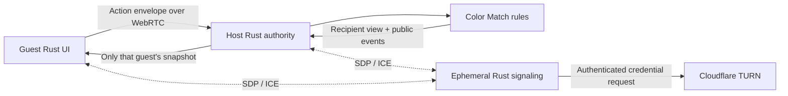

# Architecture

Rust owns game rules, bot policy, host acceptance and DOM rendering. JavaScript
connects browser WebSocket/WebRTC APIs and runs temporary animation overlays and audio.
No rules are duplicated in JavaScript. There is no database or general game framework.

| Crate / adapter | Responsibility |
| --- | --- |
| `color-match` | Private canonical state, explicit RNG, v2 rules, bot policy, public views/events, replay |
| `table-protocol` | Shared signaling/gameplay envelopes; host authority, deduplication, pauses and temporary bots |
| `table-server` | Axum/Tokio static site and authenticated ephemeral signaling; server-side TURN credential issuance |
| `board-games-web` | Browser authority or guest projection; Rust DOM updates and UI events |
| `web/bridge.js` | Authenticated signaling connection, host-centered ordered DataChannels, card motion and move audio |
| `color-match-replay` | Privileged native/WASI stdin/stdout replay command |

`Game::new(seed, GameConfig)`, `Game::apply(PlayerId, Action)` and
`Game::view_for(PlayerId)` define the rules boundary. The roster can contain
nonconsecutive IDs. Canonical state has no public fields or general Serde implementation. Explicit
privileged checkpoint export/import methods use private validated DTOs; player
snapshots never include checkpoints.
All validation precedes mutation, revision increments and RNG consumption.
Views contain one hand, public counts, phase, direction, penalties and legal
actions. Public events contain played faces and draw counts, never drawn cards.

`Authority::accept` receives the sender from the authenticated DataChannel
binding, not an action field. Authority epochs, round IDs, monotonic action IDs and revisions
prevent old actions from being applied. Every response is a fresh, individually
filtered snapshot with an acknowledgment when applicable. Deduplication stores
one high-water action ID per seat per round; IDs at or below it are duplicates,
including previously rejected requests. Old-round/epoch requests and requests
frozen during handoff do not consume IDs.

Negotiation waits for authentication on the current signaling socket. Peer work
is bound to that socket, browser session generation and authority epoch; socket
loss, departure and handoff invalidate queued callbacks and cancel peer retries.
Failed or unsent offers release their peer entry so a later offer can proceed.
An existing connection recovering with an open channel restores Rust peer
readiness even without another channel-open event. A lobby guest departure does
not change the host's signaling availability. Rust removes that peer locally
without reporting readiness for a seat already absent from its roster; the
server ignores an authenticated host's delayed readiness clear if departure
or bot reuse has already removed the human seat.

The server binds signaling senders to a room session established by a random
256-bit credential. Reconnection supersedes the previous socket generation.
Only host-to-guest or guest-to-host SDP/ICE routing is allowed. Guests keep their
credential and monotonic action counter in session storage; the host credential
exists only in the live tab, because a host reload loses authority. Invites are
separate random 256-bit identifiers. Admission locks when the host starts; room
members and their seat order remain fixed through rematches.

The browser renders from snapshots. Eight stable seat elements, stock/discard
piles and retained hand buttons preserve focus and geometry. A 350ms timer chooses
one current legal bot action at execution time. State advances independently of
Web Animations overlays (320ms for plays, 300ms for draws). A before-render hook
captures source geometry and held card IDs; an after-render hook measures the updated discard or new hand slots.
Local plays retain the complete hand card appearance, lift 18px over 65ms, then
travel to the discard over 255ms with a slight arc and rotation. Opponent plays
use the public rendered discard appearance. Draws travel as backs, with new hand
faces revealed on arrival and horizontally scrolled into view without moving focus.
Destination opacity preserves layout and keyboard access during travel. Multi-card
draws stagger arrivals over 60ms; opponent flights are capped at four backs and never
use hidden faces. Accepted moves overlap without cancelling earlier flights or
sounds. Played cards share a duration so they arrive in play order; an arrived card remains beneath later
flights until the latest discard arrives. Completion and cancellation restore presentation.
Restart, reconnect, snapshots without events, duplicate revisions and revision gaps
cancel obsolete effects. Initial deals and resynchronization do not animate or sound.
An accessible Card animations switch in room controls defaults to on independently
of the desktop reduced-motion setting and persists locally. Switching it off clears
active flights immediately; announcements, audio and state updates remain independent.
No frame loop or game engine.

Move audio is a quiet 220ms filtered-noise envelope generated with Web Audio, once
per accepted play or nonempty draw event, including opponents. AudioContext creation
and resumption occur during user interaction, following
[Web Audio guidance](https://developer.mozilla.org/en-US/docs/Web/API/Web_Audio_API/Best_practices).
An accessible toolbar switch defaults to enabled and remembers mute in local storage.
Audio and preference-storage failures silently degrade; cancellation and mute stop
active sources. There are no audio assets, dependencies or changes to rules/events.

A room pauses for disconnected humans. After 60 seconds the host can assign a
temporary bot, or keep waiting indefinitely within room lifetime. Reconnection
reclaims the seat before any subsequent bot selection. Signaling/host loss pauses
the table, with 120 seconds for the same live authority to return. There is no
saved game recovery, spectator mode, matchmaking, chat or accounts.

Bounds: 256 rooms, 512 sockets, eight seats, four-hour rooms, 32 KiB messages,
64 queued signaling events per socket, 40 messages/second per connection,
128 upgrade attempts/minute per direct remote IP and 4,096 tracked IPs. Handshakes
have a 10-second timeout; idle authenticated sockets close after 35 seconds.
TURN issuance is limited to once/minute per authenticated socket. The status line uses plain connection messages; nonvisible `data-transport` on
`#diagnostics` retains selected ICE candidate type for relay checks, excluding
credentials and SDP.

## Capacity and deliberate authority transfer

The server owns `capacity` (2–8, default eight), `host_id`, monotonic authority
`epoch`, and a per-room transfer counter. Admission and capacity changes share
the room mutex. Bots count toward capacity. Start/rematch requires two connected
humans, host-reported open DataChannels for participating guests, and no active
round. The trusted host reports round completion. Empty seats remain empty.
Transport protocol is v3; rules, replays and golden fixtures remain v2.

Lobby departures free the seat; host promotion follows human join order rather
than numeric player ID. During play, explicit departures retain credentials,
hands and seat order, and enable immediate temporary replacement. Accidental
loss retains its delay. The former host credential is saved only when deliberate
handoff completes; new hosts remove their guest credential from session storage.

For explicit host Leave, the server validates the earliest connected human with
an open host channel and announces preparation bound to host, successor, round,
epoch and unique transfer number. The host freezes moves/bots and sends a
checkpoint only over that successor's authenticated DataChannel. It includes
all cards, ChaCha seed/stream/word position, revision, round, deduplication high
water marks, temporary bots, explicit departures and elapsed disconnect durations (rebased onto the successor’s clock).
Import validates the roster, card conservation/identities and authority binding;
checkpoints and their transport wrappers retain the 32 KiB message bound.
A connection or departure change during preparation cancels the transfer so a
staged checkpoint cannot omit a later disconnect or seat reclaim.

The successor stages authority without running it, then reports readiness. The
current host confirms commit. Under the room mutex the server changes host and
increments epoch. Browsers discard old channels and animation effects, rebuild
the star around the new host, and send individually filtered snapshots. Actions,
snapshots and signaling reject obsolete epochs. Transfer attempts use unique
numbers so delayed readiness from a cancelled attempt cannot commit a retry.
Preparation expires after 15 seconds, retaining the old authority on failure.
There is no checkpoint fan-out or background replication. The successor becomes
trusted with every player's private state; ordinary guests receive only views.
Unexpected host loss continues to use the same-live-browser 120-second policy.
