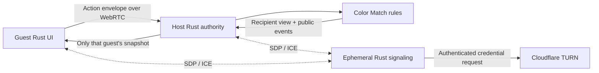

# Architecture

Rust owns game rules, bot policy, host acceptance and DOM rendering. JavaScript
connects browser WebSocket/WebRTC APIs and runs temporary animation overlays and audio.
No rules are duplicated in JavaScript. There is no database or general game framework.

| Crate / adapter | Responsibility |
| --- | --- |
| `color-match` | Private canonical state, explicit RNG, v2 rules, bot policy, public views/events, replay |
| `table-types` | Shared seat identity, independent of networking and rules |
| `game-catalog` | Discovery metadata, categories, routes and supported play modes; no protocol dependency |
| `table-protocol` | Table registrations, admission options, signaling and typed gameplay envelopes |
| `table-session` | Generic browser-host authority, deduplication, pauses and privileged handoff |
| `color-match-session` | Color Match adapter for shared authority and recipient event filtering |
| `table-server` | Axum/Tokio static site and authenticated ephemeral signaling; server-side TURN credential issuance |
| `color-match-web` | Browser authority or guest projection; Rust DOM updates and UI events |
| `web/table/transport.js` | Authenticated signaling, connection lifecycle and host-centered ordered DataChannels |
| `web/color-match/color-match-motion.js` | Color Match card motion and move audio |
| `web/color-match/bridge.js` | Thin Color Match binding entry, re-exporting transport and presentation |
| `color-match-replay` | Privileged native/WASI stdin/stdout replay command |

`Game::new(seed, GameConfig)`, `Game::apply(PlayerId, Action)` and
`Game::view_for(PlayerId)` define the rules boundary. The roster can contain
nonconsecutive IDs. Canonical state has no public fields or general Serde implementation. Explicit
privileged checkpoint export/import methods use private validated DTOs; player
snapshots never include checkpoints.
All validation precedes mutation, revision increments and RNG consumption.
Views contain one hand, public counts, phase, direction, penalties and legal
actions. Public events contain played faces and draw counts, never drawn cards.

`Authority::accept` receives the sender from the authenticated DataChannel
binding, not an action field. Authority epochs, round IDs, monotonic action IDs and revisions
prevent old actions from being applied. Every response is a fresh, individually
filtered snapshot with an acknowledgment when applicable. Deduplication stores
one high-water action ID per seat per round; IDs at or below it are duplicates,
including previously rejected requests. Old-round/epoch requests and requests
frozen during handoff do not consume IDs.

Negotiation waits for authentication on the current signaling socket. Peer work
is bound to that socket, browser session generation and authority epoch; socket
loss, departure and handoff invalidate queued callbacks and cancel peer retries.
Failed or unsent offers release their peer entry so a later offer can proceed.
An existing connection recovering with an open channel restores Rust peer
readiness even without another channel-open event. A lobby guest departure does
not change the host's signaling availability. Rust removes that peer locally
without reporting readiness for a seat already absent from its roster; the
server ignores an authenticated host's delayed readiness clear if departure
or bot reuse has already removed the human seat.

The server binds signaling senders to a room session established by a random
256-bit credential. Reconnection supersedes the previous socket generation.
Only host-to-guest or guest-to-host SDP/ICE routing is allowed. Guests keep their
credential and monotonic action counter in session storage; the host credential
exists only in the live tab, because a host reload loses authority. Invites are
separate random 256-bit identifiers. Admission locks when the host starts; room
members and their seat order remain fixed through rematches.

The browser renders from snapshots. Eight stable seat elements, stock/discard
piles and retained hand buttons preserve focus and geometry. A 350ms timer chooses
one current legal bot action at execution time. State advances independently of
Web Animations overlays (320ms for plays, 300ms for draws). A before-render hook
captures source geometry and held card IDs; an after-render hook measures the updated discard or new hand slots.
Local plays retain the complete hand card appearance, lift 18px over 65ms, then
travel to the discard over 255ms with a slight arc and rotation. Opponent plays
use the public rendered discard appearance. Draws travel as backs, with new hand
faces revealed on arrival and horizontally scrolled into view without moving focus.
Destination opacity preserves layout and keyboard access during travel. Multi-card
draws stagger arrivals over 60ms; opponent flights are capped at four backs and never
use hidden faces. Accepted moves overlap without cancelling earlier flights or
sounds. Played cards share a duration so they arrive in play order; an arrived card remains beneath later
flights until the latest discard arrives. Completion and cancellation restore presentation.
Restart, reconnect, snapshots without events, duplicate revisions and revision gaps
cancel obsolete effects. Initial deals and resynchronization do not animate or sound.
An accessible Card animations switch in room controls defaults to on independently
of the desktop reduced-motion setting and persists locally. Switching it off clears
active flights immediately; announcements, audio and state updates remain independent.
No frame loop or game engine.

Move audio is a quiet 220ms filtered-noise envelope generated with Web Audio, once
per accepted play or nonempty draw event, including opponents. AudioContext creation
and resumption occur during user interaction, following
[Web Audio guidance](https://developer.mozilla.org/en-US/docs/Web/API/Web_Audio_API/Best_practices).
An accessible toolbar switch defaults to enabled and remembers mute in local storage.
Audio and preference-storage failures silently degrade; cancellation and mute stop
active sources. There are no audio assets, dependencies or changes to rules/events.

A room pauses for disconnected humans. After 60 seconds the host can assign a
temporary bot, or keep waiting indefinitely within room lifetime. Reconnection
reclaims the seat before any subsequent bot selection. Signaling/host loss pauses
the table, with 120 seconds for the same live authority to return. There is no
saved game recovery, spectator mode, matchmaking, chat or accounts.

Bounds: 256 rooms, 512 sockets, eight seats, four-hour rooms, 32 KiB messages,
64 queued signaling events per socket, 40 messages/second per connection,
128 upgrade attempts/minute per direct remote IP and 4,096 tracked IPs. Handshakes
have a 10-second timeout; idle authenticated sockets close after 35 seconds.
TURN issuance is limited to once/minute per authenticated socket. The status line uses plain connection messages; nonvisible `data-transport` on
`#diagnostics` retains selected ICE candidate type for relay checks, excluding
credentials and SDP.

## Capacity and deliberate authority transfer

The server owns game-specific `capacity` (Color Match 2–8, default eight; CATAN 3–6, default four), `host_id`, monotonic authority
`epoch`, and a per-room transfer counter. Admission and capacity changes share
the room mutex. Bots count toward capacity. Start/rematch requires the registry minimum of connected
humans (two for Color Match, three for CATAN), host-reported open DataChannels for participating guests, and no active
round. The trusted host reports round completion. Empty seats remain empty.
Transport protocol is v5; Color Match rules/replays remain v2 and CATAN remains v1.

Lobby departures free the seat; host promotion follows human join order rather
than numeric player ID. During play, explicit departures retain credentials,
hands and seat order, and enable immediate temporary replacement. Accidental
loss retains its delay. The former host credential is saved only when deliberate
handoff completes; new hosts remove their guest credential from session storage.

For explicit host Leave, the server validates the earliest connected human with
an open host channel and announces preparation bound to host, successor, round,
epoch and unique transfer number. The host freezes moves/bots and sends a
checkpoint only over that successor's authenticated DataChannel. It includes
all cards, ChaCha seed/stream/word position, revision, round, deduplication high
water marks, temporary bots, explicit departures and elapsed disconnect durations (rebased onto the successor’s clock).
Import validates the roster, card conservation/identities and authority binding;
the session validates the final JSON-escaped wrapper against the 32 KiB transport bound.
Domain budgets remain independent: Color Match 32,768 bytes and CATAN 30,000 bytes.
A connection or departure change during preparation cancels the transfer so a
staged checkpoint cannot omit a later disconnect or seat reclaim.

The successor stages authority without running it, then reports readiness. The
current host confirms commit. Under the room mutex the server changes host and
increments epoch. Browsers discard old channels and animation effects, rebuild
the star around the new host, and send individually filtered snapshots. Actions,
snapshots and signaling reject obsolete epochs. Transfer attempts use unique
numbers so delayed readiness from a cancelled attempt cannot commit a retry.
Preparation expires after 15 seconds, retaining the old authority on failure.
There is no checkpoint fan-out or background replication. The successor becomes
trusted with every player's private state; ordinary guests receive only views.
Unexpected host loss continues to use the same-live-browser 120-second policy.

## Catalog and isolated releases

The root catalog reads a small registry through `/catalog.json`; it imports no
Wasm or game presentation. Each game has its own page and navigations unload the
previous runtime. Color Match and CATAN have independent browser artifacts. The
[CATAN contract](games/catan.md) describes its Rust rules, wgpu renderer,
room controls and native/WASI replay execution.

`make build` uses `scripts/build_web.py` to compile each game in a temporary
directory and hash all runtime files, including JavaScript and CSS. It publishes
`/assets/<game>/<hash>/` before atomically replacing the generated entry
page. Hashed files receive immutable cache headers; entry pages and catalog
metadata revalidate. Relative Wasm bridge imports resolve within that same
release. Historical asset directories are retained locally; deployments should
retain them across rolling releases. The application stays inert until runtime
initialization succeeds, with retry and catalog navigation outside the inert tree.

Protocol v5 binds create/join/resume and room views to immutable game/rules IDs.
The server checks these before admission and credential rebinding; checkpoint
import also checks their binding. Color Match rule/replay versions are unchanged.
Older clients must reload. No rooms or authority checkpoints are migrated. The server no longer depends on Color Match. Rules
share only seat identity from `table-types`, not signaling code. Generic authority
uses an explicit game adapter and filters events separately for each snapshot
recipient. Color Match's adapter returns its already-public events unchanged.

The catalog link requests authenticated departure and waits for the existing
handoff completion before navigating when in a room. Failed handoff leaves the
current authority and page active. Unexpected tab closure retains the existing
loss-of-authority limitation. The `table-browser` Rust library supplies the shared connection lifecycle through
a regular generic `RoomClient<Binding>`, compiled independently into both browser artifacts. Game-specific
DOM controls and presentation remain in their respective crates.

CATAN uses `catan` for private canonical state, validated transactional actions,
recipient views/events and bounded checkpoints. `catan-session` adapts it to the
shared authority. Room setup is host-configurable before start and bound during
checkpoint validation. `catan-web` renders only projected views with wgpu and
semantic DOM controls. `catan-replay` executes privileged deterministic fixtures
natively or as a WASI component; it is never served to ordinary guests.

## Protocol and browser lifecycle boundaries

`RoomOptions` is tagged by game, rejects unknown fields, and supplies registry defaults.
Color Match has no configurable fields. CATAN carries `BoardSetup`; its adapter translates
that option into domain `Setup` when constructing the authority. Signaling updates are
host-only and pre-start. Checkpoint imports validate both game/rules identity and options.
`GameAdapter` has no constructor; callers use explicit domain configuration and
`Authority::with_game`. Scalar Color Match metadata reads canonical fields directly.

`table-protocol` exports `protocol.js` via its `export-browser` Rust example. The build
includes those exact generated definitions in each hashed release; isolated VM transport
tests evaluate the same exporter output. Message limits count UTF-8 bytes in both
languages. Channel names, seat/action storage namespaces and host deadlines derive from
protocol definitions. Rules and replay versions are independent of protocol versions.

`RoomClient` owns room, authority, peers, projected snapshots and staged handoffs.
Its transitions receive time, round seeds and action IDs explicitly and return typed
effects. Wasm wrappers release the application-state borrow before executing transport,
render, navigation and error effects. Bindings in each session crate construct the
concrete authority and expose projected viewer, revision and completion metadata.
The generic lifecycle has no DOM or clock dependency and can run in native tests.

Shared browser-only DOM helpers validate required static IDs during startup. Dynamic
controls remain game-owned. `web/shared/loading-shell.js` owns initialization, progress,
failure, retry and enabling the application. Optional `web/table/table-controls.js` owns
invite, room dialog and copy-link behavior, with explicit CATAN panel hooks. Fallible runtime imports are
inside its error boundary, so failed imports and missing static elements show a retryable
failure instead of leaving an unexplained loading screen.

The games deliberately retain distinct rejection samplers. Changing thresholds or random
draw consumption would change subsequent replay state, even if the distributions appear
equivalent. No shared sampler, route-search optimization or wasm-opt change is included.

## Catalog ownership and optional table sessions

This is one browser-games catalog; board games are a category, not a requirement
for every runtime. `game-catalog` owns descriptive metadata, preview labels,
routes and supported play modes. It does not depend on table packages. Its test-only
protocol dependency verifies table modes and registrations in both directions.
`table-protocol` retains typed room options, seat limits, bots, rules versions and
admission availability. Transport remains v5; Color Match rules remain v2 and CATAN v1.

Maintained browser assets live in `web/color-match/`, `web/catan/`, `web/catalog/`,
`web/shared/` and `web/table/`. Templates remain game-owned in `site/`.
`scripts/build_web.py` declares each game's crate, template, assets and optional
table integration. It validates registrations and required inputs before compiling,
then flattens only that game's dependencies into its independent hashed release.
The root and existing game URLs, including legacy Color Match invites, are unchanged.
Infrastructure and deployment identities remain unchanged.

A runtime can use the startup shell with only `app`, `loading-controls`,
`load-status` and `retry-load` elements and an initializer. Table integration is
optional, imported inside the startup error boundary. Solo startup requires no
room DOM, transport imports or network connection. Tests provide a synthetic
solo page through request interception; no placeholder game or fixture route is published.

`table-session`, `table-browser` and `web/table/` are optional table infrastructure.
Fixed rosters, rounds/rematches, disconnect pauses and bounded snapshots/checkpoints
are table-session policies. Authority, recipient privacy, reconnection and deliberate
handoff remain unchanged. These packages are not a universal real-time engine.

A future survival game starts with solo play and local saves, an original setting
and assets, and a focused exploration/scavenging/survival loop. It owns its Rust
simulation, world representation, rendering and versioned saves. Its renderer,
world/entity performance investigation and detailed save design require a separate
game plan. Browser Wasm runs the browser simulation; WASI is a separate useful
headless simulation/replay target, not a browser requirement. Cooperative networking
is a later milestone. This foundation introduces no survival game, inventory system
or universal save format.

Fixture builds publish into `target/browser-test-site/` and the isolated test server
selects it with `WEB_ROOT`; production retains `web/`. This prevents a concurrent
`make dev` from replacing pages under browser tests or exposing test controls in dev.
