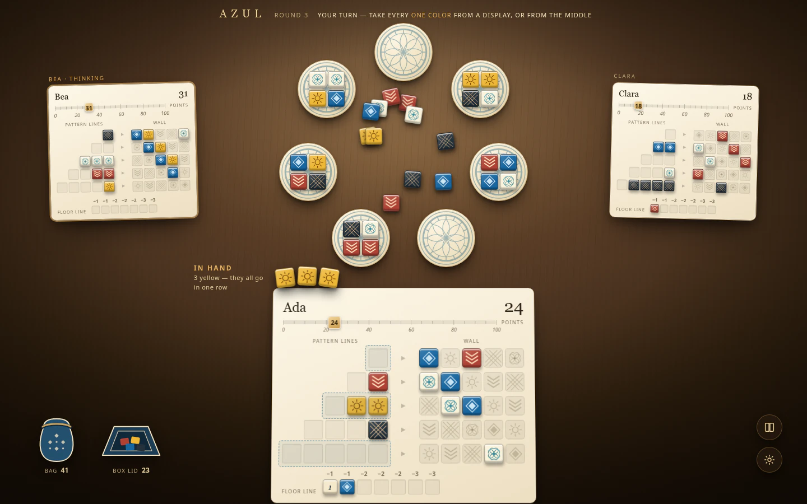

# Azul redesign

The Azul table works and is validated, but it does not feel like a table. This folder is the accepted redesign — **Table Light** — written up so it can be implemented without re-deriving any of it.

Presentation only. No rules, projection, event or networking change, which keeps it inside the boundary [ADR 013](../adr/013-three-game-delivery.md) set. The decision is recorded in [ADR 017](../adr/017-azul-table-light.md); the rules the table implements are unchanged and stay in [Azul rules](../games/azul.md).

_Design mockup, not a screenshot of the running application._

## What the redesign changes

Five things, in the order they matter:

1. **The factory displays form a circle at every player count.** Today the ring only applies at five or fewer, so three- and four-player games — seven and nine displays — are laid out as two flat rows and never read as a table.
2. **Opponents become real boards.** Today they are text strips with `▪▫▫` glyphs, so you cannot see anyone's mosaic, which is most of what makes Azul social.
3. **The middle of the table holds loose tiles.** Today it is a legend of colour counts.
4. **There is a score track.** Today there is a number.
5. **The table is lit.** Walnut under a lamp, boards tilted with a real shadow, Marcellus and Karla instead of Arial.

Alongside those, the five tile colours stop being written out in three places inside the game package and become one module.

## The documents

| File                          | What it is for                                                                                |
| ----------------------------- | --------------------------------------------------------------------------------------------- |
| [migration](migration.md)     | The phased plan. Start here. Nine phases, plus three contracts that break quietly if ignored. |
| [tokens](tokens.md)           | Every colour, font, surface and measurement, and which hard-coded value it replaces.          |
| [components](components.md)   | Each part of the table: what it is now, what it becomes, what must not change.                |
| [motion](motion.md)           | The six animated beats, the events that already drive them, and the sound.                    |
| [mobile](mobile.md)           | The 390×844 layout, breakpoints, tap targets and safe areas.                                  |
| [screenshots](screenshots.md) | Before and after, side by side.                                                               |
| [mockups](images/README.md)   | The rendered artboards and what each one shows.                                               |

## A note on the images

Everything under `images/` is a **design mockup**, not a capture of the running application — the opposite of [`docs/evidence/azul/`](../evidence/azul/README.md), which holds actual browser screenshots and says so. Nothing in these mockups exists in the codebase yet. After implementation, new captures go in the evidence directory under its existing convention and [screenshots](screenshots.md) gains a third column; the mockups stay as the specification.
