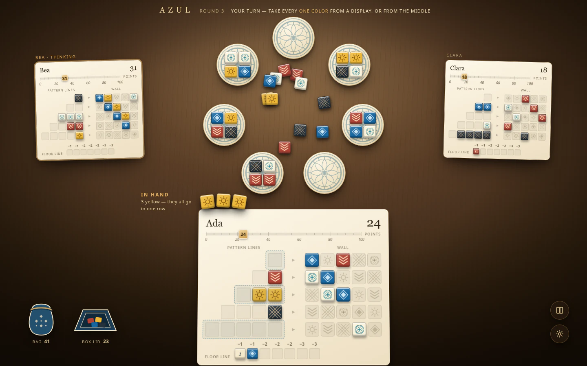
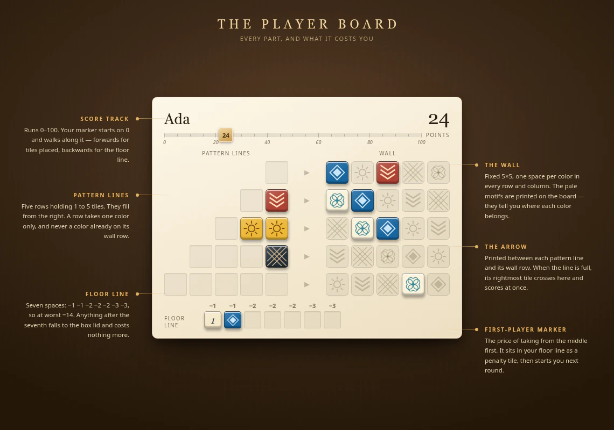

# Azul redesign: components

What each part of the table is today, what it becomes, and what must not change while it does. Values live in [tokens](tokens.md); the order of work is in [migration](migration.md).

_Design mockup, not a screenshot of the running application._

## Two corrections from the rulebook

Both were confirmed against the Next Move rulebook during the redesign, and both changed the design:

- **The retail player board is flat printed cardboard. Nothing is recessed.** Tiles sit loose on top, which is exactly why the Crystal Mosaic overlay expansion exists. Empty pattern-line squares are therefore printed outlines with a barely-there fill, not wells with deep inner shadow.
- **The faded tile motifs are printed on the wall, not on the pattern lines.** The pattern lines are plain outlined squares carrying no colour information at all. The current implementation already gets this right and must keep getting it right.

One detail worth stealing that the current table does not have: the retail board prints a small black **▶** between each pattern line and its wall row, telling you where that row's completed tile goes.

## The table surface

Today `.azul-table` is a flat navy `radial-gradient(ellipse at 50% 35%, #254b63 0, #142c43 60%, #102333 100%)` with `font-family: Arial, Helvetica, sans-serif` and a thin brass hairline inset 10px from the edge.

It becomes dark walnut under a single warm lamp: the wood gradient, a lamp pool centred slightly above the middle, an overlay grain layer, and a vignette that lets the corners fall into the room. The brass hairline goes; the light does that job now. Type becomes Marcellus for display and Karla for interface text.

The heading strip stays where it is — wordmark, round number, and the live `aria-live="polite"` turn line — but sits directly on the table rather than in a bordered band.

Keep: the `.azul-table` and `.surface` class names, the `data-game-revision` attribute, `lang`, the `isolation: isolate`, and the internal scrolling of `.surface`. The browser suite reads all of them.

## Corner controls

The book and gear buttons keep their position, their 48px size, their `env(safe-area-inset-*)` offsets and their accessible names. Only the material changes: a warmer disc against walnut instead of `#18384bd9` against navy. Their inline SVG icons are unchanged.

## The factory display

Today `.factory` is a 112px circle filled with an eight-stop `radial-gradient` whose hard colour stops read as concentric bands rather than print.

It becomes a printed cardboard disc: a soft radial for the card stock, a real edge, a drop shadow that puts it on the table, and an azulejo rosette drawn as inline SVG in `--azul-disc-print` at 42% opacity underneath the tiles. Four tiles still sit in a 2×2 grid; empty positions still render `.factory-empty` placeholders, because those carry `data-azul-location` anchors that animation measures against.

## The ring

This is the biggest single change and the reason the table does not currently read as a table.

`platePosition()` in `Board.svelte` puts plates on a circle only when there are five or fewer. Above that it falls back to two flat rows — `index < top ? [12 + …, 17.5] : [22 + …, 82.5]` — so a three-player game (seven displays) and a four-player game (nine) never form a ring at all. A separate `max-width: 600px` rule replaces the whole thing with a three-column grid on phones.

It becomes one circle at every player count, on every viewport: equal radii, plate size and radius scaled to the space, and the start angle rotated so no plate sits directly under the heading. Five, seven and nine all work; the two-row branch and the phone grid override both go.

The open middle of that circle **is** the centre pool, which is how the physical game works and why the ring matters: the pool visibly swells as the displays empty.

## The centre pool

Today `.center` is a 330px box holding a row of five `.center-group` buttons, each a faded tile with a count beneath it — a legend, not a pile. The first-player marker sits at the end of the row.

It becomes loose tiles scattered in the middle of the ring, sitting where they fell, with the marker among them until someone takes it. The pile grows through the round.

This is the one change with a real interaction cost, and it must not regress: taking from the centre means taking **every** tile of one colour, so a scatter of individually-positioned tiles still needs one hit target per colour. The implementation keeps a per-colour grouped control — same accessible name built from `m.azul_source`, same disabled state when the count is zero, same selected state — while the tiles it covers are positioned individually. The `center/{color}` and `center/marker` anchors stay on the tiles themselves so flights still land in the right place.

The browser suite selects `.center-group:enabled` and clicks a control named `Take 4 · Blue diamond · Center`. Both must survive.

## The player board

### Score track

There is no score track. `PlayerBoard.svelte` renders the score as a bare number in the header, which is the single largest departure from the physical board — where the track runs along the top, 0 to 100, and your marker is a tile-shaped token that walks along it.

It becomes a rail across the top of the board with ticks every five, numerals every twenty, and a small square marker riding it at the current score. The bare number stays too, at display size, because it is what players actually read; the track is what makes scoring feel like movement rather than arithmetic. When the floor line is paid, the marker walks backwards.

### Pattern lines

Five rows of one to five squares, right-aligned against the wall, filling right to left. This is already correct and already tested — the suite asserts that the first `.slot` in a row renders to the right of the second. Keep it.

What changes: the rows hug their squares instead of spanning the column, so a legality highlight can wrap the squares rather than drawing a wide empty bar; and each row keeps a minimum 44px height, which on a phone is the whole tap target.

The `.row-issue` overlay (`This line is full.` and its siblings) stays exactly as it is.

### The arrow

New. A ▶ in `--azul-chevron` printed between each pattern line and its wall row, in a narrow column between the two grids. Decorative and `aria-hidden`; the accessible labels already say which row is which.

### The wall

A fixed 5×5 grid, one space per colour per row and column, with the empty cells printing the faded colour that belongs there. Already correct. The printing gets stronger — 15% fill and 55% motif rather than a 12% mix — because at opponent-board size the current version is invisible.

The scored-run highlight keeps its brass outline and keeps being driven by the `scoring.cells` the game already reports.

Keep: the per-cell `data-azul-location="{id}/wall/{r}/{c}"`, and the `Wall row 1, column 1 · Blue diamond · Empty` accessible name, which the suite matches exactly.

### The floor line

Seven spaces with `−1 −1 −2 −2 −2 −3 −3` printed above them. Today they are pushed to the right-hand edge of the board; on the retail board they run along the bottom left, under the pattern lines. They move there.

On the physical board each space is a small Moorish arch with its penalty numeral set into it, which reads as architecture rather than as a debt tracker. Table Light keeps the printed numerals and the plain squares — the arches belong to the more literal direction that was not chosen — but the row moves to where the eye expects it.

Keep the `Floor line` accessible name and the per-slot anchors.

## The tile

The best-looking thing on the current table and nearly unchanged: a glazed body with a top-light gradient, a bevel from inset shadows, and an original SVG motif per colour. It gains a slightly stronger cast shadow so it sits on the board under the lamp, and it takes its colour from `palette.ts` rather than from CSS blocks.

`class="tile {color}"` stays. The suite asserts the accepted board's markup contains the literal string `tile blue`.

## Opponent boards

Today each opponent is a `.opponent` text card: name, score, a `X in patterns · floor 0/7` risk line, and a row of `▪▫▫` glyph patterns. You cannot see anyone's mosaic, which is most of what makes Azul social — the whole game is watching someone else's wall fill up and deciding what to deny them.

They become real boards, rendered through the same `PlayerBoard` component at `--tile: 19px`, with labels and penalty numerals dropped at that size. The card is still a button that opens the full-size board in the existing dialog.

Keep: the `.opponent` class, the `.turn` modifier, the `data-azul-location="{id}/summary"` anchor — animation falls back to it when an opponent's individual squares are not on screen — and the `m.azul_inspect` accessible name.

## The bag and the box lid

Today these are the literal characters `♧` and `◇` in `.reserves` with a count beside each.

They become small original SVG props at the table edge: a blue-and-white azulejo drawstring bag, and a shallow open box lid with a few discarded tiles in it. Both keep their counts and both keep their `bag` and `discard` anchors, because the deal animation flies out of the bag and the discard is where floor tiles go.

## What is not touched

Rules, validation, the public projection, the event union, the revision gate, the confirmation bar, the results ledger and the help dialog. This is presentation only, inside the boundary ADR 013 already set.

One implementation detail is easy to break and worth stating: `Board.svelte` renders from a `visual` snapshot held separately from the live view, and swaps it only after measuring element positions. That indirection is what makes animation possible. It must stay the render source; rendering from the live view directly would break every flight.
