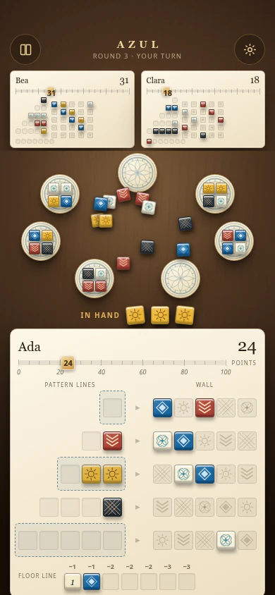

# Azul redesign: mobile

Chrome and Safari are required targets and touch is a first-class input, so the phone layout is part of the design rather than a fallback from it.

_Design mockup, not a screenshot of the running application._

## The layout at 390×844

Top to bottom, as a single non-scrolling column:

| Band       | Height | Contents                                                    |
| ---------- | ------ | ----------------------------------------------------------- |
| Status bar | 48px   | Left empty. The OS draws here.                              |
| Header     | 52px   | Book button, wordmark with round and turn line, gear button |
| Opponents  | ~106px | Every opponent as a real board, side by side                |
| The ring   | 220px  | All displays in a circle, pool in the middle                |
| In hand    | 32px   | The tiles you have just picked up                           |
| Your board | ~361px | Full board, pattern lines at 44px rows                      |

The table does not scroll on a phone in this design. Today `.surface` scrolls internally and the browser suite checks it does not scroll _horizontally_; vertical scrolling stays available as a safety valve for larger text sizes, but the default state fits.

## Opponents stay boards

This is the point of the mobile layout, not a compromise in it. Opponents render through the same `PlayerBoard` component at `--tile: 8px`, with labels, penalty numerals, chevrons and the score-track ticks hidden at that size — the wall pattern and the score are still legible, and that is what you actually look at.

They do not become text summaries. The current phone build shows the same `▪▫▫` glyph strips as desktop, which tells you nothing about anyone's mosaic.

Tapping one still opens the full-size board in the existing dialog, which is where the detail lives.

## The ring holds its circle

Today a `max-width: 600px` rule throws away the ring entirely and lays displays out as a three-column grid capped at 360px wide.

In this design the circle survives: radius and plate size shrink together, plates go to 56px on a 79px radius, and seven of them still leave a 12px gap between neighbours. The open middle is still the pool. A ring is what tells you at a glance how much of the round is left, and a grid does not.

## Tap targets

- **Every pattern-line row is 44px tall.** That is why `--row` is larger on a phone (44px) than on desktop (38px) even though the tiles are smaller (27px against 34px) — the row is the target, not the tile. The browser suite already asserts `.own-board .pattern:enabled` has a bounding-box height of at least 44.
- **Floor spaces** keep their own targets at 24px squares inside a row that clears 44px.
- **Factory tiles** are 44px buttons wrapping a smaller tile, as they are today.
- **Corner controls** stay 44px minimum with their existing `env(safe-area-inset-*)` offsets.
- Everything interactive inherits the existing `min-height: 44px` on `button`.

## No fake chrome

Nothing is drawn in the status-bar band and there is no painted home indicator. On a real device the OS renders both on top of the page; a painted copy reads as a doubled-up mockup. The bottom of the board respects `max(16px, env(safe-area-inset-bottom))`.

## Breakpoints

Three, replacing the current set:

| Range                        | Change                                                                                                      |
| ---------------------------- | ----------------------------------------------------------------------------------------------------------- |
| ≤ 600px                      | Phone layout: `--tile: 27px`, `--row: 44px`, opponents at `--tile: 8px`, ring radius and plates scaled down |
| 601–1100px                   | `--tile: 30px`, opponents at `--tile: 14px`, ring at intermediate scale                                     |
| ≥ 1100px with ≥ 900px height | Full desktop table as drawn in [components](components.md)                                                  |

The `max-width: 600px` factory-grid override is deleted rather than adjusted.

## What still needs a human

WebKit automation covers the layout, the tap-target heights and the absence of horizontal scroll. It does not establish Safari on a real device, actual touch quality, or audio behaviour on iOS — the existing [owner handoff](../handoffs/azul.md) is explicit about this and it stays true after the redesign. Text-enlargement behaviour at 200% should be re-checked once the score track exists, since it adds a dense row of small numerals that the current board does not have.
