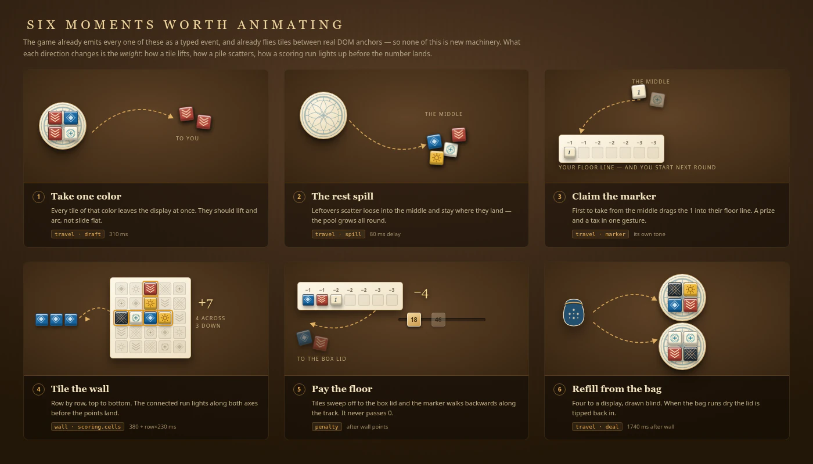

# Azul redesign: motion

Six moments carry the round. All six already exist: they are typed events in `games/azul/src/index.ts`, and `games/azul/src/effects.ts` already flies tiles between real DOM anchors and plays a tone. **This is a restyle of motion that already ships, not new machinery.**

_Design mockup, not a screenshot of the running application._

## The six beats

| Beat                                         | Event               | Delay today                           | Travel today | What the redesign changes                                                                  |
| -------------------------------------------- | ------------------- | ------------------------------------- | ------------ | ------------------------------------------------------------------------------------------ |
| Take every tile of one colour off a display  | `travel` · `draft`  | 0                                     | 310ms        | Tiles lift and arc rather than sliding flat; the cast shadow grows on the way up           |
| The leftovers slide to the middle            | `travel` · `spill`  | 80ms                                  | 310ms        | They scatter into a loose pile and stay where they land, instead of incrementing a counter |
| First pick from the middle claims the marker | `travel` · `marker` | 0                                     | 310ms        | The marker gets its own weight and its own voice, landing in the floor line                |
| Tiling the wall, row by row                  | `wall`              | `380 + row × 230`ms                   | 240ms        | The connected run lights along both axes before the number lands                           |
| Paying the floor                             | `penalty`           | after wall points                     | —            | Tiles sweep off to the box lid and the score marker walks backwards along the new track    |
| Refilling the displays                       | `travel` · `deal`   | 1740ms after a wall event, else 430ms | 310ms        | Tiles come out of the bag prop, four to a display                                          |

Keep every one of those numbers unless there is a reason to change it. They were tuned against real play and the tail timeout that re-enables input is derived from them.

## The flying tile is styled in JavaScript

This is the trap. `.azul-flight` has **no CSS rule anywhere in the repository** — the class name appears only in `effects.ts` and in the browser test. Every visual property is assigned inline in `tileFlights()`, and the node is appended to `document.body`, outside `.azul-table`, so a Svelte scoped style cannot reach it and neither can a custom property declared on the table.

Today it sets a flat background from the `paints` map, a unicode glyph as text content, `borderRadius` of `50%` for the marker and `5px` otherwise, `fontSize: 23px`, and `boxShadow: inset 0 2px 1px #ffffff88, 1px 4px 6px #0005`.

Restyling `Tile.svelte` alone therefore leaves every flight looking like the old design. The flight has to be brought in line in the same change — either by reading the same values from `palette.ts` and applying the redesign's relief, or by mounting a real tile into the flight node. Mounting a real tile also retires the unicode glyphs, which exist only because the flight is a `` with text in it.

Four things the browser suite pins about flights, all of which must survive:

- the class name `azul-flight`
- the node being appended at `document.body` level
- a Web Animations animation reachable as `getAnimations()[0]`
- a first keyframe whose transform literally contains `translate(0,0)`, and a later keyframe whose transform does not

## Measurement is the other trap

`measure()` collects every `[data-azul-location]` element into a map of bounding rectangles, and **skips any element with zero width or height**. A flight whose start or end anchor is missing from that map is silently dropped — no error, no fallback, the tile simply never moves.

So any restyle that makes a source element `display: none`, collapses it to zero size, or removes its anchor attribute breaks the corresponding animation without breaking a test that only checks that _some_ flight happened. The anchors are:

`factory/{index}/{slot}`, `center/{color}`, `center/marker`, `bag`, `discard`, `{id}/pattern/{row}/{slot}`, `{id}/wall/{r}/{c}`, `{id}/floor/{slot}`, `{id}/marker`, `{id}/summary`

`{id}/summary` is the fallback: when an opponent's individual squares are not rendered, `effects.ts` retargets the flight at their summary card. Opponent boards becoming real boards means those individual anchors start existing, which is an improvement — flights will land on the actual square — but the summary anchor must stay for the phone layout and for the collapsed case.

## Sound

`ceramicAudio()` plays a single sine oscillator per hit: 880Hz rising to 1320Hz for scoring, 360Hz for the marker, 680Hz falling to 220Hz for a tile, with gain at `volume × 0.12` and a 110ms decay.

The real table has **three** distinct sounds, and using one voice for all of them is the largest remaining gap between this and sitting at a table:

- the **rain** of four tiles dropping onto a display during the deal — many small impacts, loose
- the **scrape** of leftovers being swept into the middle — a massed rattle, not a click
- the **clack** of one tile pressed onto the wall — sharp, singular, and simultaneous across all players during wall-tiling

Three voices, still synthesised, still no audio files. This is the one genuine addition in this document rather than a restyle; it is optional and can land after the visual work.

Unchanged: audio only unlocks from a trusted gesture, mute cancels scheduled sources, and unavailable audio never blocks play.

## Reduced motion

Everything above is suppressed when motion is reduced, and the Skip button settles instantly to the canonical state. Both already work and neither changes. The redesign must keep the still, reduced-motion frame legible on its own — which is why the scoring run's lit cells and the score-track marker position are canonical state rendered from `scoring.cells`, not animation-only decoration.

The motion preference is a three-way setting persisted to browser storage, with a live listener for the system preference. Unchanged.
