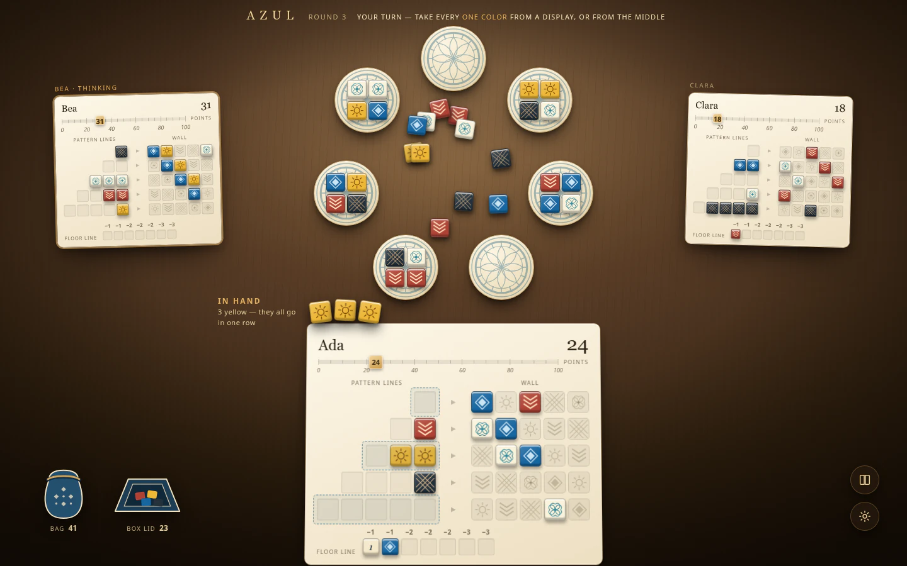
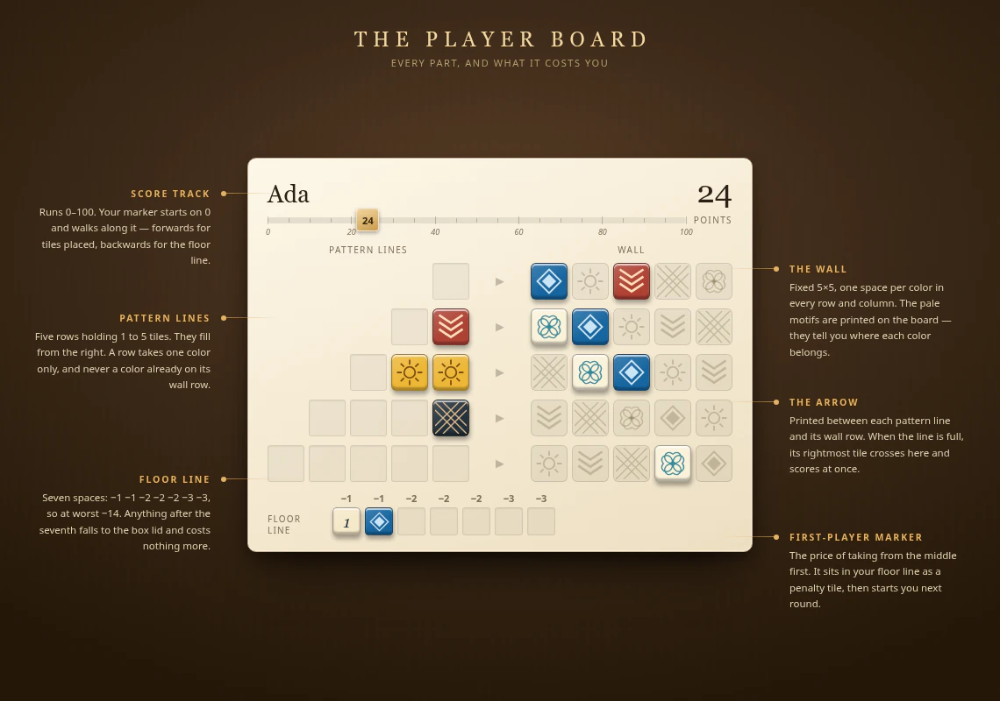
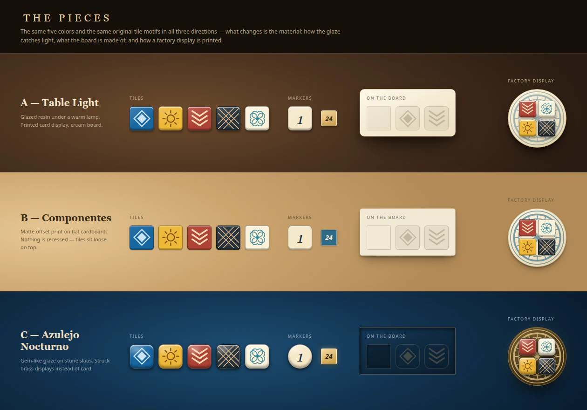
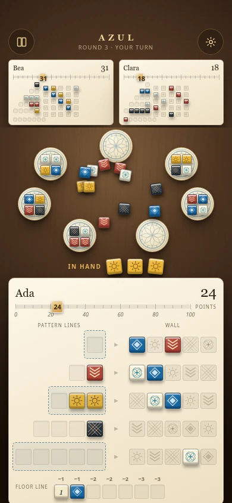
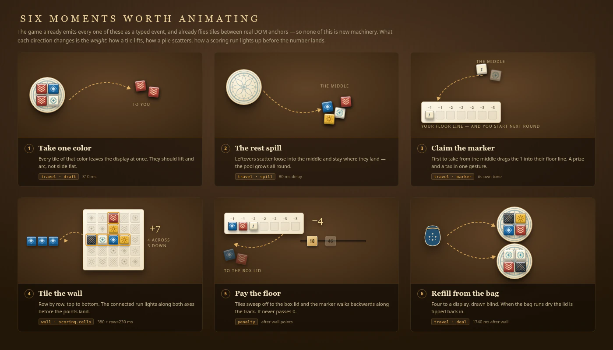

# Azul redesign: before and after

The left column is the table as it ships today, captured from the running application during implementation. The right column is the accepted design, rendered from the Table Light mockups. **They are different kinds of artefact** — one is a browser screenshot, the other is a design target — and nothing in the right column exists in the codebase yet.

Sources: [Azul visual evidence](../evidence/azul/README.md) for the captures, [mockups](images/README.md) for the targets.

## The desktop table

| Today                                                                                    | Table Light                                                                         |
| ---------------------------------------------------------------------------------------- | ----------------------------------------------------------------------------------- |
| [`azul-desktop-four.png`](../evidence/azul/azul-desktop-four.webp) — 1440×900, four seats | [`table-light-desktop.webp`](images/table-light-desktop.webp) — 1440×900, three seats |

What changed, in the order you notice it:

1. **The displays form a circle.** In the capture, nine displays are laid out as a row of five above a row of four, because the ring only applies at five or fewer. Here seven sit on one circle with the pool in the middle.
2. **The middle holds tiles.** The capture shows five faded colour icons with `0` beneath each and the marker off to one side — a legend. Here it is a loose pile that grows through the round.
3. **You can see the other players' walls.** The capture reduces Bea, Clara and Diego to three text strips with `0 in patterns · floor 0/7` and `▪▫▫` glyphs. Here they are real boards.
4. **There is a score track.** The capture has `0 points` as a number. Here a marker rides a 0–100 rail.
5. **The table is a table.** Walnut under a lamp instead of a navy gradient, boards tilted four degrees with a real shadow, Marcellus and Karla instead of Arial.
6. **The bag and the box lid are objects** rather than the characters `♧` and `◇`.

## The player board

| Today                                                                        | Table Light                                                         |
| ---------------------------------------------------------------------------- | ------------------------------------------------------------------- |
| Visible in [`azul-desktop-four.png`](../evidence/azul/azul-desktop-four.webp) | [`player-board.webp`](images/player-board.webp) — annotated, 1140×800 |

Correct already and kept: pattern lines filling right to left, the faded colour printed in each empty wall cell, the `−1 −1 −2 −2 −2 −3 −3` floor values, the accessible names on every cell.

New: the score track and its marker, the ▶ printed between each pattern line and its wall row, the floor line moved to the bottom left where the retail board puts it, stronger wall printing so it survives at opponent-board size.

## The pieces

Three rows, one per direction explored. The middle and bottom rows are the two directions that were **not** chosen — kept here because the material choice only means something against its alternatives. The top row is Table Light.

The five tile colours are identical in all three and identical to what ships today. What differs is the material: glaze under a warm lamp, matte offset print, gem-like under gold.

## The phone

| Today                                                                   | Table Light                               |
| ----------------------------------------------------------------------- | ----------------------------------------- |
| [`azul-phone-four.png`](../evidence/azul/azul-phone-four.webp) — 390×844 | [`phone.webp`](images/phone.webp) — 390×844 |

The capture keeps the desktop compromises: text-strip opponents, and the ring replaced entirely by a three-column grid. The design keeps opponents as boards and keeps the circle. See [mobile](mobile.md).

## Motion

Six beats, each labelled with the event that already drives it and the timing already in the code. See [motion](motion.md); the animation that exists today is recorded in `workshop-motion.webm` and `review-motion.webm` under the evidence directory.

## After implementation

The captures above stay as the before. New evidence goes in `docs/evidence/azul/` under the existing convention — actual browser screenshots, labelled as such — and this page gets a third column rather than having the mockups replaced. The mockups are the specification and stay useful for checking that what shipped is what was agreed.
