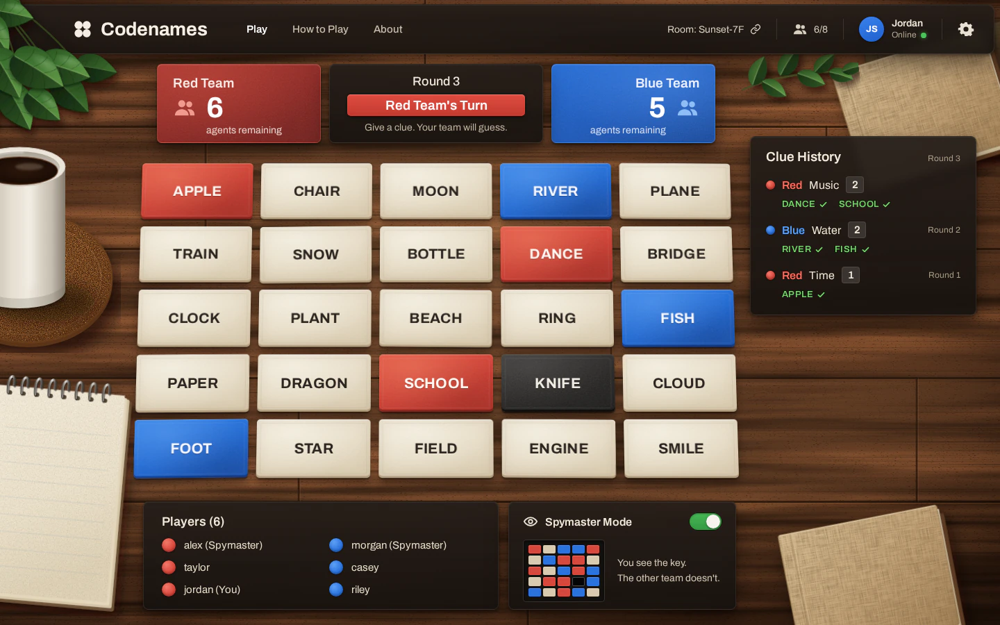

# Codenames Table redesign

**Status:** implemented 2026-09-13; validation is recorded in the [evidence](../evidence/codenames/table-redesign/README.md).

The checked-in realistic reference (`images/reference.webp`) takes precedence
for materials, warm upper-left lighting and restrained card edges. The mockup and
migration still determine structure, gameplay and responsive behavior. Original
locally bundled WebP wood and transparent props replace procedural wood and SVG
props; this is an approved asset exception. All interface text is Svelte/CSS.
Chat, writing, slogans and branding on props remain excluded. The follow-up wood/panel
correction restores asset loading and visible grain through tinted panels; see the
[current materials](tokens.md#implemented-materials). The later
[card close-up](images/card-reference.webp) guides the paper finish and removal
of inset frames. The latest [team/glass reference](images/team-glass-reference.webp)
supersedes transparent team fills: opaque textured teams, smoked glass elsewhere,
condensed typography and word-only cards. Private identity handling and the
exterior focus ring remain. Desktop composition is now capped and centred from
1024px upward, with history centred beside the word grid; see the current
[layout tokens](tokens.md#implemented-materials).

A realistic wooden-table look for Codenames:

- Paper word cards with printed thickness and cast shadows.
- A glass header with room, seats and viewer.
- Red and blue team panels with a round/turn banner.
- Clue History.
- Players and a spymaster key panel.
- Original decorative props: plant, mug, notepad, books.

To apply it, the rules must also change. Clues, counts, the active team and rounds
become stored, enforced state again, which supersedes part of
[ADR 018](../adr/018-codenames-voice-table.md).

| Document                  | Purpose                                                                              |
| ------------------------- | ------------------------------------------------------------------------------------ |
| [Migration](migration.md) | Milestones for the implementing agent: ADR, rules engine, UI, compact layouts, tests |
| [Tokens](tokens.md)       | Materials, colours, contrast, typography, geometry, icons and a CSS block            |
| [`source/`](source/)      | Design markup (`Main.dc.html`) and the superseded SVG prop studies                   |

## Images

Everything under `images/` is a **design mockup or reference, not a capture of the
running app**.

| File                                                      | What it is                                                                                                              |
| --------------------------------------------------------- | ----------------------------------------------------------------------------------------------------------------------- |
| [`design-desktop.webp`](images/design-desktop.webp)       | 1440×900 render of `source/Main.dc.html` at 1:1. Structural target; materials defer to the realistic reference.         |
| [`design-top@2x.webp`](images/design-top@2x.webp)         | 2× crop: header and team row                                                                                            |
| [`design-grid@2x.webp`](images/design-grid@2x.webp)       | 2× crop: word grid, paper and revealed card materials                                                                   |
| [`design-history@2x.webp`](images/design-history@2x.webp) | 2× crop: Clue History                                                                                                   |
| [`design-panels@2x.webp`](images/design-panels@2x.webp)   | 2× crop: Players and Spymaster Mode panels                                                                              |
| [`reference.webp`](images/reference.webp)                 | The product owner's original inspiration. Its chat panel and the handwriting on objects are intentionally **excluded**. |

The migration plan lists where the mockup deliberately differs from the rules, for
example the revealed assassin and the key visible to an operative.

Before-images of the superseded voice-led table are already in the repository and are
not duplicated here:

- [desktop](../evidence/codenames/voice-table/desktop.webp)
- [phone](../evidence/codenames/voice-table/phone.webp)
- [spymaster](../evidence/codenames/voice-table/spymaster.webp)

No phone mockup exists. Compact layouts follow the written rules in
[migration § 4](migration.md#4-compact-layouts).

The editable design canvas lives outside the repository at
<https://claude.ai/code/artifact/ae83c7e6-3608-49a3-ad55-0f2f89176f9d> (private to its
owner). `source/Main.dc.html` is the checked-in structural copy. The realistic reference
and the migration corrections take precedence where they conflict.
